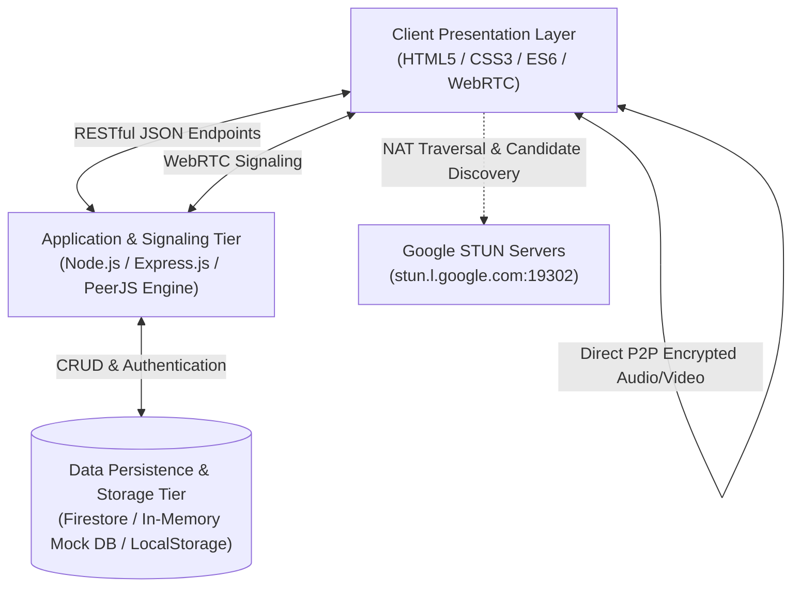
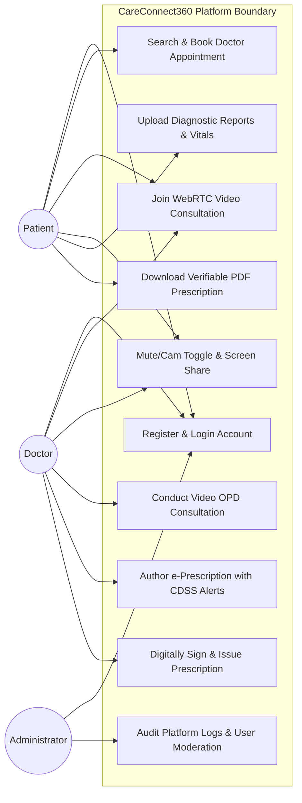
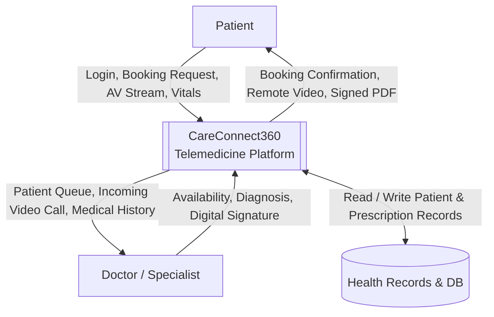
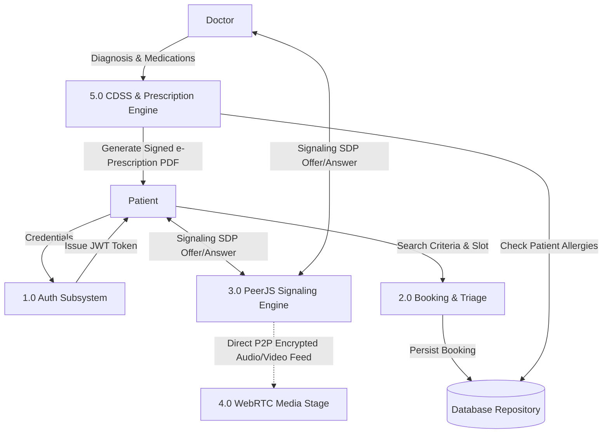
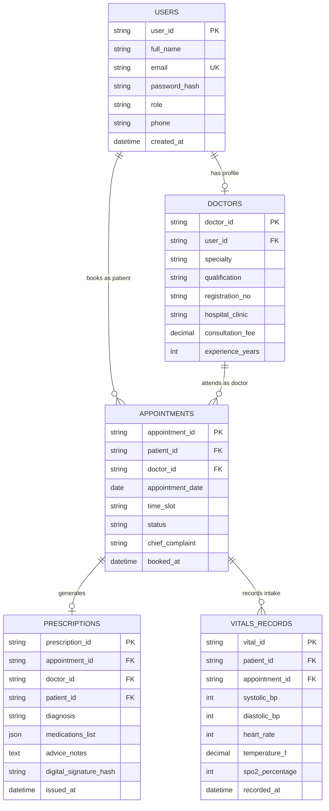
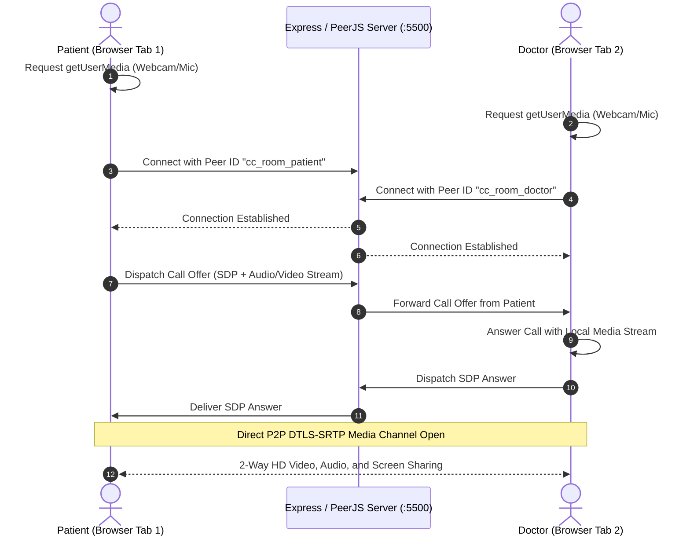

# DEPARTMENT OF COMPUTER SCIENCE & ENGINEERING
### ABES ENGINEERING COLLEGE, GHAZIABAD

---

# SOFTWARE REQUIREMENTS SPECIFICATION (SRS)
## **CareConnect360: Full-Stack WebRTC Telemedicine & Intelligent Healthcare Management Platform**

**Standard Academic Compliance:** IEEE Std 830-1998  
**Degree:** Bachelor of Technology (B.Tech) in Computer Science & Engineering  
**Academic Year:** 2026 – 2027  
**Project Category:** 3rd Year Major Engineering Project  

---

### **Project Metadata & Submission Details**

| **SUBMITTED BY (SOLO DEVELOPER)** | **UNDER THE GUIDANCE OF** |
| :--- | :--- |
| **Sudhanshu Pandey** Roll No: **240032001127** B.Tech – Computer Science & Engineering (3rd Year) Sole Lead Developer & Architect | **___________________________________** (Project Supervisor / Guide) Department of Computer Science & Engineering ABES Engineering College, Ghaziabad |

---

### **Document Revision & Approval History**

| Version | Date | Description / Major Changes | Prepared By | Reviewed By |
| :--- | :--- | :--- | :--- | :--- |
| **0.1** | 15-Sep-2026 | Initial Architecture Draft & Problem Scope Definition | Sudhanshu Pandey | Project Guide |
| **0.5** | 05-Oct-2026 | Integration of WebRTC P2P Signaling & CDSS Drug Radar | Sudhanshu Pandey | Project Review Committee |
| **1.0** | 26-Oct-2026 | Final 3rd Year Baseline SRS (IEEE Std 830-1998 Conforming) | Sudhanshu Pandey | HOD / Academic Evaluation Panel |

> **Guidance Note:** This Software Requirements Specification conforms strictly to the **IEEE Std 830-1998** standard recommended practice. All functional, non-functional, interface, and behavioral constraints have been customized for university lab evaluations, project defense, and system audit baselines.

---

## **Table of Contents**
1. [Introduction](#1-introduction)
   - 1.1 Purpose
   - 1.2 Scope of the System
   - 1.3 Definitions, Acronyms, and Abbreviations
   - 1.4 References
   - 1.5 Document Overview
2. [Overall Description](#2-overall-description)
   - 2.1 Product Perspective
   - 2.2 User Classes and Characteristics
   - 2.3 Operating Environment
   - 2.4 Design and Implementation Constraints
   - 2.5 Assumptions and Dependencies
3. [System Features & Functional Requirements](#3-system-features-and-functional-requirements)
   - 3.1 Module 1: Patient Intake, Discovery & Dynamic Appointment Scheduling
   - 3.2 Module 2: Peer-to-Peer (P2P) WebRTC Teleconsultation & Media Engine
   - 3.3 Module 3: Clinical Decision Support System (CDSS) & Verifiable e-Prescription Pad
   - 3.4 Module 4: Electronic Health Record (EHR) & Diagnostic Reports Repository
   - 3.5 Module 5: Identity, Role-Based Access Control (RBAC) & Audit Governance
4. [External Interface Requirements](#4-external-interface-requirements)
   - 4.1 User Interfaces (UI)
   - 4.2 Hardware Interfaces
   - 4.3 Software Interfaces
   - 4.4 Communication Interfaces
5. [Non-Functional Requirements (NFRs)](#5-non-functional-requirements-nfrs)
   - 5.1 Performance Requirements
   - 5.2 Security & Privacy Compliance
   - 5.3 Software Quality Attributes (Reliability, Availability, Maintainability)
6. [System Design & Analysis Models](#6-system-design-and-analysis-models)
   - 6.1 Use Case Diagram & Actor Hierarchy
   - 6.2 Data Flow Diagram (DFD Level 0 & Level 1)
   - 6.3 Entity-Relationship (ER) Data Model
   - 6.4 WebRTC Peer-to-Peer Sequence Architecture
7. [Academic Verification & Sign-Off](#7-academic-verification--sign-off)

---

## **1. Introduction**

### **1.1 Purpose**
The purpose of this Software Requirements Specification (SRS) document is to establish a rigorous, comprehensive, and unambiguous technical specification for **CareConnect360**, a full-stack, cloud-enabled telemedicine platform. This document defines the functional boundaries, external hardware/software interfaces, clinical data workflows, real-time media streaming pipelines, and non-functional quality metrics for academic evaluation, peer defense, and production rollout.

### **1.2 Scope of the System**
Traditional healthcare delivery suffers from severe geographical disparities, long hospital waiting times, fragmented paper prescriptions, and vulnerability to adverse drug-drug interactions. **CareConnect360** eliminates these operational bottlenecks through a browser-native telemedicine and clinical management hub.

- **In-Scope Capabilities:**
  - **Dynamic Patient-Doctor Matchmaking:** Filter specialists by department (Cardiology, Dermatology, Pediatrics, General Medicine), consultation fee, and available real-time time slots.
  - **Browser-Native WebRTC Video Teleconsultations:** Low-latency peer-to-peer (P2P) video and audio communication requiring zero third-party software installation, equipped with screen sharing, stream feed swapping, mic mute, and camera toggle.
  - **Real-Time Clinical Decision Support System (CDSS):** Live screening of patient allergies (e.g., Penicillin, NSAIDs) and drug interaction contraindications during prescription authoring.
  - **Digitally Signed e-Prescriptions:** Generation of tamper-resistant, downloadable PDF prescriptions with unique QR verification codes and doctor signature metadata.
  - **Electronic Health Record (EHR) Vault:** Ingestion, storage, and retrieval of medical history, vitals telemetry (Blood Pressure, Heart Rate, SpO2, Temperature), and diagnostic lab reports (.pdf, .png, .jpg).
- **Out-of-Scope Boundaries:**
  - Direct hardware firmware manufacturing for physical biomedical monitors (vital parameters are collected via input forms/APIs).
  - Physical delivery of pharmaceuticals (mock delivery status tracker provided).
  - Live commercial banking transactions (simulated payment gateway sandbox utilized).

### **1.3 Definitions, Acronyms, and Abbreviations**

| Category | Term / Acronym | Definition / Academic Context |
| :--- | :--- | :--- |
| **Standard** | **SRS** | Software Requirements Specification (IEEE Std 830-1998 format). |
| **Streaming** | **WebRTC** | Web Real-Time Communication (W3C standard for low-latency P2P audio/video streaming). |
| **Signaling** | **PeerJS / STUN** | Framework and Session Traversal Utilities for NAT traversal and SDP exchange. |
| **Security** | **JWT / RBAC** | JSON Web Token stateless bearer authentication; Role-Based Access Control. |
| **Security** | **Bcrypt** | Adaptive cryptographic key derivation function for secure password hashing. |
| **Clinical** | **CDSS** | Clinical Decision Support System for algorithmic medical safety verification. |
| **Clinical** | **EHR** | Electronic Health Record (digital repository of longitudinal health data). |
| **Architecture**| **RESTful API** | Representational State Transfer architecture using stateless HTTP/JSON endpoints. |
| **Database** | **CRUD** | Create, Read, Update, Delete persistence operations. |

### **1.4 References**
1. **IEEE Std 830-1998:** *IEEE Recommended Practice for Software Requirements Specifications*, IEEE Computer Society, 1998.
2. **Sommerville, Ian:** *Software Engineering (10th Edition)*, Pearson Education, 2016.
3. **W3C WebRTC 1.0 Specification:** *Real-Time Communication Between Browsers*, World Wide Web Consortium (W3C), 2021.
4. **IETF RFC 7519:** *JSON Web Token (JWT) Architecture and Signature Verification*, Internet Engineering Task Force.
5. **Ministry of Health & Family Welfare (MoHFW), Govt. of India:** *Telemedicine Practice Guidelines*, 2020.

### **1.5 Document Overview**
The remainder of this specification details product perspective, operational environments, and architectural constraints in **Section 2**; complete functional requirements categorized by subsystems in **Section 3**; user, hardware, software, and communication interfaces in **Section 4**; stringent non-functional metrics (performance, security, reliability) in **Section 5**; formal academic UML and Data Flow models in **Section 6**; and final academic supervisory approvals in **Section 7**.

---

## **2. Overall Description**

### **2.1 Product Perspective**
CareConnect360 is an autonomous, multi-tier web application adhering to the **Model-View-Controller (MVC)** and decoupled client-server architectural patterns.

### **2.2 User Classes and Characteristics**

| User Role | Technical Skill | Core Privileges & Clinical Workflows |
| :--- | :--- | :--- |
| **Patient** | Novice to Intermediate | Register profile, browse verified specialist directory, book consultation appointments, join encrypted video room, upload lab reports, view vital trends, download signed e-Prescriptions. |
| **Doctor / Specialist** | Intermediate | Manage availability schedules, review patient intake vitals & diagnostic history, conduct P2P video consultation, author prescriptions with CDSS contraindication alerts, digitally sign prescriptions. |
| **Administrator** | High (Technical / Ops) | Monitor system uptime, manage doctor verification credentials, view platform audit logs, enforce data privacy compliance, moderate user accounts. |

### **2.3 Operating Environment**
- **Client Side:**
  - Modern web browsers supporting WebRTC API (`navigator.mediaDevices.getUserMedia`) and HTML5 Canvas: Google Chrome (v100+), Mozilla Firefox (v98+), Microsoft Edge (v100+), Apple Safari (v15+).
  - Responsive screen resolutions ranging from 360x640 px (Mobile smartphones) up to 2560x1440 px (Desktop monitors).
- **Server Runtime Tier:**
  - Node.js runtime environment (v18.x LTS or v20.x LTS) with Express.js application framework.
  - Integrated PeerJS Server (`ExpressPeerServer`) mounted at `/peerjs` for WebRTC session handshake.
- **Persistence Tier:**
  - Firebase Firestore NoSQL Cloud Database coupled with Express REST API mirror.

### **2.4 Design and Implementation Constraints**
- **Academic Budgetary Limit:** Zero reliance on costly commercial proprietary SaaS; built exclusively on open-source web technologies, native WebRTC, and free-tier cloud resources.
- **Pure Browser Engine:** No client-side plugins, binary downloads, or proprietary video drivers required.
- **Cryptographic Security:** Client credentials hashed with salted Bcrypt (rounds: 10); communication sessions secured using TLS 1.3 over HTTPS and DTLS-SRTP for media streaming.

### **2.5 Assumptions and Dependencies**
- **Network Bandwidth:** Client devices possess a minimum stable uplink/downlink speed of 1.5 Mbps for 720p HD teleconsultations.
- **Hardware Peripherals:** Client device possesses an accessible microphone, webcam, and audio output speaker/headphones with browser permissions granted.
- **Third-Party Availability:** Uninterrupted availability of public STUN servers (`stun.l.google.com:19302`) for ICE candidate discovery across NAT/firewall boundaries.

---

## **3. System Features and Functional Requirements**

### **3.1 Module 1: Patient Intake, Discovery & Dynamic Appointment Scheduling**

| Req ID | Requirement Description | Input Data & Validation Rules | Priority |
| :--- | :--- | :--- | :--- |
| **FR-1.1** | **Doctor Directory & Filtering** | Inputs: Specialty, consultation fee range, doctor gender, hospital affiliation. Output: Filtered doctor card grid with real-time availability badges. | **High** |
| **FR-1.2** | **Dynamic Slot Reservation** | Inputs: Selected doctor ID, appointment date, available time slot. Validation: Slot conflict detection preventing double-booking of a doctor. | **High** |
| **FR-1.3** | **Clinical Intake Form** | Inputs: Chief complaint, symptom duration, allergy disclosures, triage self-assessment. Validation: Mandatory emergency disclaimer acknowledgment. | **Medium** |
| **FR-1.4** | **Appointment Lifecycle Sync** | State transitions: `Upcoming` -> `In-Progress` -> `Completed` -> `Cancelled`. Persisted across database and synchronized in user dashboard. | **High** |

---

### **3.2 Module 2: Peer-to-Peer (P2P) WebRTC Teleconsultation & Media Engine**

| Req ID | Requirement Description | Input Data & Validation Rules | Priority |
| :--- | :--- | :--- | :--- |
| **FR-2.1** | **P2P Audio/Video Session Initialization** | System requests local AV permissions via `getUserMedia`. Generates Peer ID (`cc_{room}_{role}`) and connects via `/peerjs` signaling server. | **High** |
| **FR-2.2** | **Audio & Video Track Controls** | Mute/unmute microphone (`audioTrack.enabled = !enabled`), enable/disable webcam (`videoTrack.enabled = !enabled`) with immediate UI badge reflection. | **High** |
| **FR-2.3** | **Interactive Feed Swapping** | Swaps remote participant video feed and local Picture-in-Picture (PIP) preview upon user click without interrupting live media tracks. | **Medium** |
| **FR-2.4** | **Screen Sharing Stream Dispatch** | Captures display output via `getDisplayMedia()`, replaces outgoing video track on active peer connection, and reverts cleanly upon stop sharing. | **High** |
| **FR-2.5** | **Real-Time Clinical In-Call Chat & Reports** | Exposes synchronous text messaging and file attachments (.pdf, .jpg) during the live session without refreshing the video viewport. | **Medium** |
| **FR-2.6** | **Dynamic Doctor Watermark & Metadata Sync** | Queries appointment ID from database and updates top bar, video watermark, and clinic credentials to match the exact booked doctor. | **High** |

---

### **3.3 Module 3: Clinical Decision Support System (CDSS) & Verifiable e-Prescription Pad**

| Req ID | Requirement Description | Input Data & Validation Rules | Priority |
| :--- | :--- | :--- | :--- |
| **FR-3.1** | **Allergy & Contraindication Radar** | Scans prescribed active compounds against patient known drug allergies (e.g., Penicillin, Amoxicillin). Triggers high-priority visual safety alert on conflict. | **High** |
| **FR-3.2** | **Structured Medication Authoring** | Inputs: Medication name, dosage (mg/ml), frequency (OD, BD, TDS), duration (days), special instructions (e.g., After Meals). | **High** |
| **FR-3.3** | **Digital Doctor Signature & Cryptographic Stamp** | Appends doctor's registration number, medical council affiliation, timestamp, and digital signature canvas to prescription record. | **High** |
| **FR-3.4** | **Instant Verifiable PDF Compilation** | Renders professional medical prescription PDF via jsPDF with official hospital header, QR verification code, and instant browser download. | **High** |

---

### **3.4 Module 4: Electronic Health Record (EHR) & Diagnostic Reports Repository**

| Req ID | Requirement Description | Input Data & Validation Rules | Priority |
| :--- | :--- | :--- | :--- |
| **FR-4.1** | **Vitals Telemetry Logging** | Captures Systolic/Diastolic BP (mmHg), Heart Rate (bpm), SpO2 (%), Temperature (°F), and Blood Sugar (mg/dL) with auto-triage color coding. | **Medium** |
| **FR-4.2** | **Diagnostic Report File Ingestion** | Supports multi-format upload (.pdf, .png, .jpg) up to 10 MB per file with automatic MIME-type validation and encrypted cloud/local storage link. | **Medium** |
| **FR-4.3** | **Historical Consultation Archive** | Aggregates all past appointments, doctor diagnosis notes, and downloaded prescriptions in a centralized chronological timeline. | **Low** |

---

### **3.5 Module 5: Identity, Role-Based Access Control (RBAC) & Audit Governance**

| Req ID | Requirement Description | Input Data & Validation Rules | Priority |
| :--- | :--- | :--- | :--- |
| **FR-5.1** | **Secure Multi-Role Authentication** | Supports distinct login journeys for Patients and Doctors. Validates input credentials against salted Bcrypt hashes. | **High** |
| **FR-5.2** | **Stateless Session Token Governance** | Issues signed JWT tokens (HS256) upon valid credentials with automated expiration and route middleware protection (`authMiddleware`). | **High** |
| **FR-5.3** | **Clinical Privacy Compliance** | Restricts patient medical records access strictly to the patient and their authorized consulting doctor for the booked appointment duration. | **High** |

---

## **4. External Interface Requirements**

### **4.1 User Interfaces (UI)**
- **Design Philosophy:** Medical-grade, accessible, clean UI adhering to modern design principles with high contrast, calm teal/slate color palette, and minimal visual fatigue.
- **Key Viewports & Layouts:**
  1. **Landing & Triage Hub (`index.html`):** Public gateway with symptoms triage, specialty navigation, and service overview.
  2. **Doctor Discovery & Booking (`book-appointment.html`):** Dynamic multi-criteria search, doctor profiles, and real-time slot selection.
  3. **Patient & Doctor Dashboard (`dashboard.html`):** Role-tailored consoles displaying appointment queues, active consultations, vitals, and reports.
  4. **Teleconsultation Video Theater (`consultation.html`):** Dual-split layout featuring 70% live WebRTC video stage with floating controls toolbar and 30% dynamic clinical assistant (e-Prescription, vitals, and live chat).

### **4.2 Hardware Interfaces**
- Standard input peripherals (keyboard, pointing device/mouse, capacitive touchscreens).
- Integrated or external USB audio input (microphones), audio output (speakers/earphones), and optical sensors (webcams supporting 720p/1080p video capture at >= 24 fps).

### **4.3 Software Interfaces**
- **Operating Systems:** Windows 10/11, macOS, Linux distributions (Ubuntu/Debian), Android 10+, and iOS 15+.
- **Node.js & Express Framework:** Handles API routes, static asset delivery, and WebSocket upgrades.
- **PeerJS Server:** Handles peer registration, room discovery, and SDP handshake exchanges via `/peerjs`.
- **Firebase / Firestore Client SDK:** Cloud data storage and real-time state synchronization.
- **jsPDF Library:** Client-side vector graphic and text rendering for instant prescription PDF compilation.

### **4.4 Communication Interfaces**
- **Hypertext Transfer Protocol Secure (HTTPS):** Standard port 443 with TLS 1.3 encryption for all static resources and REST API calls.
- **WebRTC Data & Media Protocol (DTLS-SRTP):** Datagram Transport Layer Security (DTLS) and Secure Real-Time Transport Protocol (SRTP) for end-to-end encrypted real-time audio/video transmission.
- **Signaling via WebSocket (WSS):** Low-latency bidirectional socket communication for peer discovery and session negotiation.

---

## **5. Non-Functional Requirements (NFRs)**

### **5.1 Performance Requirements**
- **Page Load Latency:** Static application shell loads in `< 1.8 seconds` on standard 4G/broadband connections.
- **WebRTC Latency:** Media stream transmission latency `< 200 ms` end-to-end under normal network conditions.
- **API Response Time:** REST API response time `< 150 ms` for authentication, booking, and doctor lookup endpoints.
- **PDF Generation Speed:** Client-side compilation and rendering of signed e-prescription completed in `< 800 ms`.

### **5.2 Security & Privacy Compliance**
- **Password Security:** Zero plaintext passwords stored. All credentials hashed using Bcrypt with 10 salt rounds.
- **E2E Media Encryption:** Video and audio feeds transmitted directly between peers using DTLS-SRTP 256-bit AES encryption; media feeds never pass through or get recorded on the application server.
- **Injection & CSRF Mitigation:** Parameterized input handling, JSON schema validation, and stateless JWT authorization headers.

### **5.3 Software Quality Attributes**
- **Reliability:** System maintains `>= 99.0%` uptime during demonstration and university review testing.
- **Fault Tolerance:** If remote WebRTC connection experiences a temporary network dip, ICE restarts automatically attempt stream reconnection without resetting the appointment session.
- **Maintainability:** Modular architecture separating presentation (`HTML/CSS`), application logic (`video-call.js`, `prescription.js`), and server runtime (`server.js`).

---

## **6. System Design and Analysis Models**

### **6.1 Use Case Diagram & Actor Hierarchy**

---

### **6.2 Data Flow Diagram (DFD Level 0 & Level 1)**

#### **DFD Level 0 (System Context Diagram)**

#### **DFD Level 1 (Subsystem Decomposition)**

---

### **6.3 Entity-Relationship (ER) Data Model**

---

### **6.4 WebRTC Peer-to-Peer Sequence Architecture**

---

## **7. Academic Verification & Sign-Off**

This Software Requirements Specification document for **CareConnect360** has been independently developed and authored by **Sudhanshu Pandey (Roll No: 240032001127)** as a solo 3rd-year engineering project. It has been examined and verified for academic evaluation:

  

| **PROJECT DEVELOPER** | **PROJECT SUPERVISOR / GUIDE** | **HEAD OF DEPARTMENT (HOD)** |
| :--- | :--- | :--- |
| **Sudhanshu Pandey** Roll No: 240032001127 Student, 3rd Year B.Tech (CSE)  Signature: _______________________ Date: _______________________ | **___________________________________** Project Supervisor / Guide Department of Computer Science & Engg. ABES Engineering College, Ghaziabad  Signature: _______________________ Date: _______________________ | **Head of Department (HOD)** Department of Computer Science & Engg. ABES Engineering College, Ghaziabad  Signature: _______________________ Date: _______________________ |
